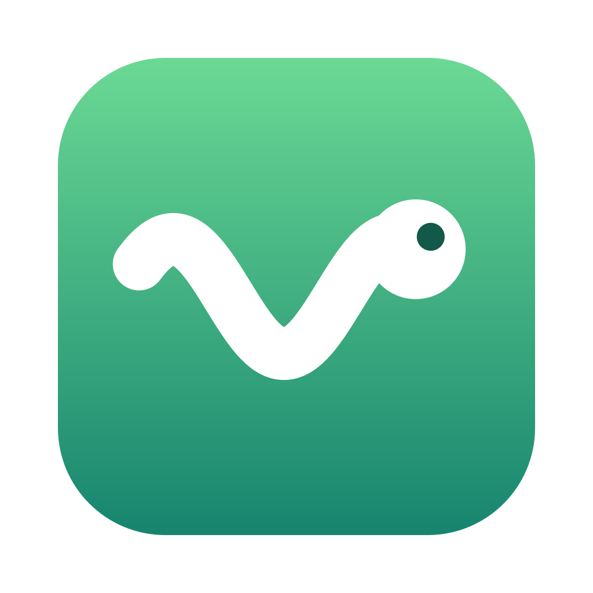

<p align="center">
  
</p>

<h1 align="center">Wiggle</h1>

<p align="center">
  A tiny macOS menu bar app that nudges the mouse 1px (and back) every 1–2 minutes
  so the screen never sleeps or locks.
</p>

<p align="center">
  <a href="https://github.com/hnilsen/wiggle/releases/latest"><b>Download the latest release</b></a>
</p>

- **Left-click** the worm icon to turn wiggling on/off. It wiggles while on and lies flat (dimmed) while off.
- **Right-click** (or ctrl-click) for the menu: status and time to next wiggle, Settings…, Quit.
- **Settings** lets you pick the min/max time between wiggles (10 s – 10 min). Each wiggle fires at a random time in that range.

## Build

Requires macOS 13+ and the Xcode command line tools.

```sh
./scripts/build-app.sh
cp -R build/Wiggle.app /Applications/
open /Applications/Wiggle.app
```

During development you can also run `swift run`.

## Releases

Pushing a tag starting with `v` builds a universal (Apple Silicon + Intel) app on
GitHub Actions and attaches `Wiggle-<tag>.zip` to a GitHub Release:

```sh
git tag v1.0.0 && git push origin v1.0.0
```

The release build is ad-hoc signed, not notarized, so macOS blocks it the first
time you open it. Either run `xattr -dr com.apple.quarantine /Applications/Wiggle.app`, or
try to open it once, then click **Open Anyway** under
**System Settings → Privacy & Security**.

## Accessibility permission

Posting mouse events requires **System Settings → Privacy & Security → Accessibility**.
The app prompts on first launch. Until you grant it, the menu shows a *Grant Accessibility Permission…* item.

The build is ad-hoc signed, so macOS treats each rebuild as a new app. After rebuilding,
remove Wiggle from the Accessibility list and add it again (or toggle it off and on).

## Launch at login

Enable **Start at Login** in the right-click menu or in Settings. Wiggle always starts
switched **off** (at login and on every launch); click the worm to turn it on.

This only works when running the bundled `Wiggle.app` (ideally from `/Applications`),
not via `swift run`.
